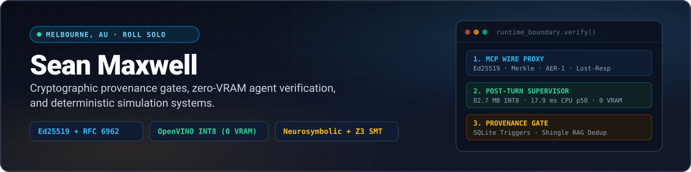

  

  
  
  
  
  
  
  

---

### Shipped Systems & Open-Source Infrastructure

| System | Scope & Architecture | Artifacts & Verification |
| :--- | :--- | :--- |
| **[`epistemic-guard`](https://github.com/AlienatedAliens/epistemic-guard)** `Python` · `MIT` | Out-of-process MCP receipt proxy (`HKDF-SHA256` + `Ed25519`, `RFC 6962` Merkle logs, `OpenTelemetry` + optional `AER-1` export), CPU/NPU OpenVINO INT8 post-turn prose supervisor (`82.7 MB` supervisor / `279.5 MB` 4-model pack, `17.9 ms` median turn latency, `0 MiB` VRAM), SQLite provenance write-gate, and `k=4` shingle/SimHash RAG wire-copy deduplication. | [PyPI](https://pypi.org/project/epistemic-guard/) · [INT8 Weights](https://huggingface.co/RollSolo/epistemic-guard-int8) · [Benchmarks](https://huggingface.co/datasets/RollSolo/epistemic-guard-benchmarks) · [Live Space](https://huggingface.co/spaces/RollSolo/epistemic-guard) |
| **[`ProjectLucca`](https://github.com/AlienatedAliens/ProjectLucca)** `Python / Scheme / Z3` | Local-first 4-process neurosymbolic agent runtime partitioning inference across dGPU (`26B MoE`), Intel NPU (`INT8` classifiers), iGPU (`NLI` cross-encoder), and gas-bounded `MicroScheme` / `Z3 SMT` rule quarantine. | [Source](https://github.com/AlienatedAliens/ProjectLucca) · [`Luccadocs` Ledger & Errata](https://github.com/AlienatedAliens/Luccadocs) |
| **[Roll Solo](https://rollsolo.app)** `Production Platform` | Live AI-native solo tabletop RPG platform pairing deterministic tabletop rule resolution and persistent campaign state with AI GM narration (*Member of NVIDIA Inception* · *Google for Startups Cloud Program*). | [rollsolo.app](https://rollsolo.app) |

---

### Preprints & Pre-Registered Technical Reports *(Not Peer-Reviewed)*

*Developed using AI-assisted workflows gated by strict static/layer contracts (`mypy --strict`, `import-linter`), pre-registered holdouts, and [`osaudit`](https://github.com/ASSERT-KTH/osaudit) SHA-256 provenance verification.*

| Study | Focus & Measured Findings | Identifier |
| :--- | :--- | :--- |
| **Provenance-Gated Memory (`N=100` / `1,500` runs)** | Domain-separated cryptographic write-gating cuts multi-session RAG self-poisoning from `100%` (naive RAG) to `0%` with `0/200` benign false rejections. | [DOI `10.5281/zenodo.23901452`](https://doi.org/10.5281/zenodo.23901452) |
| **Speech-Regex Overfitting & `SOAC` (`N=120`)** | Documents held-out collapse of surface regex matchers (`23/23` in-sample &rarr; `1/16` held-out) and introduces receipt-bound supervision. | [DOI `10.5281/zenodo.23901605`](https://doi.org/10.5281/zenodo.23901605) |
| **5-Layer Memory & `Z3` Rule Quarantine** | Paraconsistent Belnap 4-valued conflict routing (`MiniLM-L6` INT8) + `Z3` SMT verification and 50-turn shadow replay for procedural rule induction. | [DOI `10.5281/zenodo.23901683`](https://doi.org/10.5281/zenodo.23901683) |
| **Foundational Technical Report & Pre-Registration** | Baseline failure measurements, NLI timeout audit, and pre-registered SHA-256 evaluation protocol. | [DOI `10.5281/zenodo.23649049`](https://doi.org/10.5281/zenodo.23649049) |
